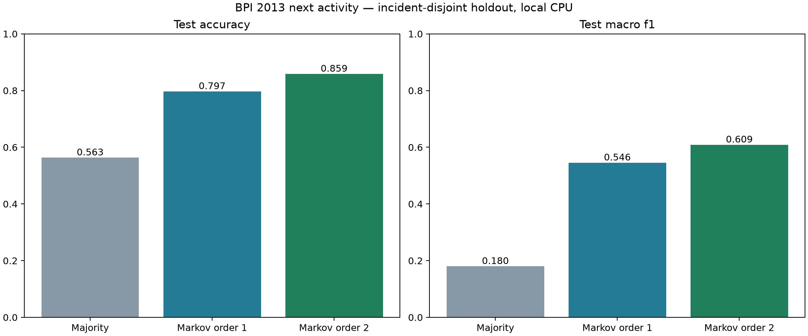

# Data analysis and next-activity benchmark

Run date: October 19, 2026 (America/Chicago). Machine-readable timestamps use UTC.

## What was executed

The seven full pipeline runs were re-profiled locally with output checksum
verification. Existing Bronze/Silver/Gold processing was reused, preserving source
identity, provenance, quarantine accounting and the unknown-timezone policy.
Azure Blob Storage contains the 38-file upload; this analysis used the matching
local pipeline outputs. It did not execute on Azure compute or read back and hash
all Azure blobs.

The corpus contains 54,160 accepted incidents, 65,533 BPI 2013 events and 10,000
sample log records. BPI 2014 has 203 quarantined source rows without incident IDs.
See [EDA evidence](../eda/README.md) and [aggregate analysis](../eda/analysis.json).

## Research and decisions

| Reference | Observed approach | Decision for this repository |
| --- | --- | --- |
| [LogPAI Loglizer](https://github.com/logpai/loglizer) | Separates feature fitting, held-out transformation and evaluation; includes supervised and unsupervised log detectors | Keep training statistics separate from evaluation. Its published HDFS scores are not our results and cannot be compared to these small log samples. |
| [BEST process prediction](https://github.com/lmu-dbs/BEST) | Forecasts next activities and remaining sequences using process histories, configurable case splits and accuracy/similarity metrics | Start with transparent next-activity frequency baselines before adding complex sequence models. This run does not reproduce BEST. |
| [Kaggle Incident Impact Prediction](https://www.kaggle.com/competitions/incident-impact-prediction) | Incident-impact classification evaluated with mean F1 | Do not substitute status or severity for verified impact labels. Use macro-F1 alongside accuracy for our different target. |
| [Kaggle ITSM notebook](https://www.kaggle.com/code/pobedash/itsm-incident-prediction-minimization) | Relevant notebook located; its code was not available in the retrieved page | No claims about its preprocessing, algorithms or scores; no notebook code copied or executed. |

External repository code was not installed or executed.

## Experiment

Predict the next recorded BPI 2013 activity from an observed prefix. Activities
are ordered by `source_record` within each incident, following the source export.
This predicts recorded workflow behavior, not recommended action, root cause,
resolution quality or future production performance.

Three predeclared models:

1. Majority: most frequent training next activity.
2. Markov order 1: most frequent successor of the current activity.
3. Markov order 2: most frequent successor of the last two activities, backing
   off to shorter contexts when unseen.

All statistics are fitted on training incidents only. Ties use alphabetical order.
The stable SHA256 case split assigns 5,333 incidents to training, 1,133 to
validation and 1,088 to test. No incident is split across partitions.
Validation macro-F1 selects the order-2 model; the test set is not used for tuning.
All observed nonterminal adjacent transitions are evaluated. End-of-case prediction
is excluded. Macro-F1 averages over classes actually present in each evaluation set.

| Model | Test accuracy | Test macro-F1 |
| --- | ---: | ---: |
| Majority | 56.34% | 0.1802 |
| Markov order 1 | 79.72% | 0.5456 |
| Markov order 2 | 85.88% | 0.6089 |

Order 2 improves accuracy by 29.54 percentage points over the majority baseline.
These are one deterministic split's measured results, without confidence intervals
or multiple-seed replication.



## Generalization limits

1,033 of 1,088 test cases have an exact activity sequence seen in training.
This is separate-case evaluation, not unseen-workflow or chronological evaluation.
The additional 55 unseen-path cases yield 93.56% order-2 transition accuracy and
0.6088 macro-F1. Higher accuracy on that small subset does not establish stronger
generalization: repeated transitions and class balance change its difficulty.
Order 1 has better macro-F1 on that subset (0.6391). The validation-selected model
was not changed after seeing the subset result.

Historical first-observed events need not be true incident openings. Unknown
timezones remain unknown. Independent BPI and Loghub datasets are never joined.
The five 2,000-line Loghub samples are insufficient to claim representative
production anomaly-detection performance. Severity is not a root-cause label.

Fit time and evaluation-loop throughput are recorded in [results.json](results.json).
The latter includes Python prediction and metric bookkeeping; it is not HTTP
throughput, concurrent serving latency, GPU performance or an Azure benchmark.

## Engineering verification

The profiler verifies every recorded pipeline output checksum before reading it.
Its aggregate evidence covers nulls, source-key duplicates, synthetic flags,
timestamp coverage, source-status distributions and event-parent integrity.
Three new synthetic-sequence tests verify stable case partitioning, unseen-context
fallback, correct context-dependent predictions and evaluation without model mutation.
The combined baseline/profile/EDA targeted suite passed six tests; Ruff checks and
format checks passed for the new files. The repository exposure check passed.
Existing PostgreSQL/OpenSearch replay evidence is recorded separately in
[backend verification](../data-engineering/README.md); it was not rerun for this experiment.

## How this helps agents

An eventual process-analysis tool can return a likely next recorded activity,
support counts and uncertainty alongside source evidence. An investigation agent
would combine that bounded signal with authorized incident history and logs.
It must not treat the prediction as permission to execute remediation.
The current script is an offline baseline, not an integrated agent tool.

Next evaluation gates are a chronological split with overlapping histories purged,
case-level confidence intervals, labeled anomaly data with duplicate/template-aware
splits, and human-reviewed retrieval/investigation cases. Model serving and agent
quality need their own latency, failure-recovery and grounded-answer evaluations.

## Reproduce

```powershell
uv sync --frozen --group eda
uv run --group eda python -m scripts.eda_evidence
uv run --group eda python -m scripts.benchmark_activity
uv run pytest tests/test_activity_baselines.py tests/test_data_profile.py tests/test_eda_evidence.py -q
```

Public aggregate evidence is stored here; source records and model-training inputs
remain in ignored local data directories.
