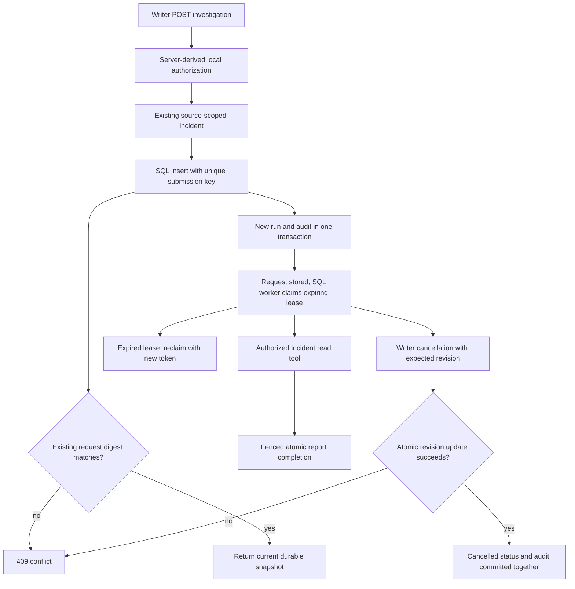

# Durable investigation submission flow

Status: **Complete** for SQL submission, lookup, revision-checked cancellation and
internal lifecycle transitions. A local SQL worker now executes deterministic
incident snapshot reports; Redis and model-backed agents remain future work.

`apps/api/investigations.py` owns HTTP inputs and local-role authorization.
`src/services/investigations.py` owns SQL transactions and transition policy.
`src/models/database.py` and migration `0002_investigation_runs` own persistence.
`tests/test_investigations.py` covers replay races, transition races, pool recreation,
authorization, cancellation rollback and sanitized database failures; its integration
case runs the same lifecycle against PostgreSQL.

`src/services/worker.py` owns claims, retry bounds and fenced completion.
`src/services/incident_worker.py` supplies the deterministic read-only handler.
`tests/test_worker.py` tests competing claims, expired-lease reclaim, stale result
rejection, cancellation, report persistence and handler failure exhaustion locally.
The worker returns evidence only, without asserting a cause or proposing an action.

Read the [Phase C contract and limits](../phase-c.md) before changing this boundary.
